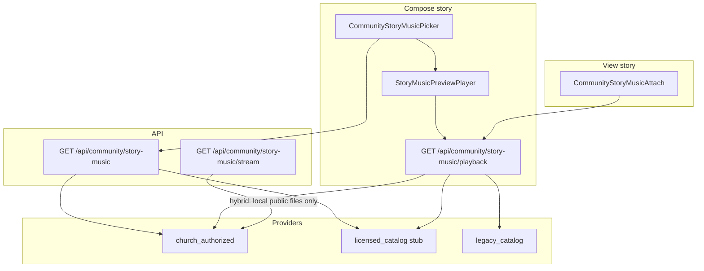

# Share Your Story — hybrid music architecture (POC)

**Branch:** `fix/story-music-hybrid` (from `main`, no Marriage Counseling Hub)  
**Status:** Local prototype — **not deployed**, **`STORY_MUSIC_HYBRID_ENABLED` off in production**

## Goals

1. Reliable **HTML5 audio** playback (desktop + Android WebView).
2. **Licensed catalog** + **church-authorized** files under one abstraction.
3. **Preview before attach** using the same `/api/community/story-music/playback` path as stories.
4. **No attach** for tracks that are not demonstrably playable.
5. **Preserve** existing `CommunityStatus.musicTrackId` values (legacy catalog remains resolvable).

## Feature flag

| Variable | Where | Purpose |
|----------|--------|---------|
| `STORY_MUSIC_HYBRID_ENABLED=1` | Server | Hybrid search, playback, attach rules, stream route (no YouTube extraction) |
| `NEXT_PUBLIC_STORY_MUSIC_HYBRID_ENABLED=1` | Client | Viewer compose/attach behavior aligned with hybrid (no YouTube fallback) |
| `STORY_MUSIC_POC_CATALOG_ENABLED=1` | Server | Expose **QA `poc-*` tracks** (local only; **never** in production) |

Production default: **unset / off** — legacy behavior via `legacy-playback-bridge.ts`.

## Provider abstraction

`StoryMusicProvider` (`src/lib/story-music/types.ts`):

| Provider | Role |
|----------|------|
| `church_authorized` | JSON catalog + files under `public/` or Blob URLs (`data/story-music-church-audio.json`) |
| `licensed_catalog` | Stub until B2B API credentials + legal sign-off (`licensed-catalog-provider.stub.ts`) |
| `legacy_catalog` | Existing `data/community-story-music.json` ids — **metadata + playback mapping only**; hybrid attach **disabled** |

Orchestration: `src/lib/story-music/story-music-service.ts`

- **Search (hybrid):** merges providers with `attachableOnly: true` → only `playability: playable`.
- **Find by id:** walks providers — legacy ids still found for published stories.
- **Playback:** owning provider resolves plan (`audio` | `youtube` | `unavailable`).
- **Attach:** `assertTrackAttachable()` — hybrid requires `playable` and **not** `legacy_catalog`.

## Data flow



## Discovery model

`src/lib/story-music/search.ts` filters:

- **Query** — title, artist, country, language, genres, tags  
- **Country** — ISO-style codes (GH, NG, ZA, KE, JM, US, MX, GB, KR)  
- **Language** — BCP-47 (`en`, `es`, `pt`, `ko`, …)  
- **Genre** — gospel, worship, contemporary_christian, hymn, instrumental  
- **Region** — legacy tag chips when hybrid is off  

## Published story compatibility

| Field stored | Behavior |
|--------------|----------|
| `musicTrackId` | Unchanged; still primary key |
| `musicYoutubeVideoId` | Still stored for display/future mapping; hybrid playback **does not** extract from YouTube |
| Legacy id (e.g. `way-maker`) | **Found** via `legacy_catalog`; hybrid playback → `unavailable` until mapped to authorized/licensed audio |

Optional later migration: add `musicProvider` / `providerTrackId` columns — not required for POC.

## POC audio

- Catalog: `data/story-music-church-audio.json`  
- Files: `public/story-music-poc/*.wav` (generated — see `public/story-music-poc/AUTHORIZATION.md`)  
- **Not** commercial gospel recordings.

## Local validation

```bash
node scripts/generate-story-music-poc-audio.mjs
STORY_MUSIC_HYBRID_ENABLED=1 NEXT_PUBLIC_STORY_MUSIC_HYBRID_ENABLED=1 npm run dev
npm run test:story-music:hybrid
```

Manual: Community → Share Your Story → attach POC track → preview → publish → view story with sound.

Android WebView: same origin audio URLs; user tap on story enables playback (Capacitor uses existing `playsInline` + sound toggle).

## Out of scope (POC)

- Production deploy  
- Licensed provider subscription  
- Bulk migration of `community-story-music.json` to licensed ids  
- YouTube / Piped / Invidious in hybrid mode  

See [STORY_MUSIC_PROVIDER_COMPARISON.md](./STORY_MUSIC_PROVIDER_COMPARISON.md) and [STORY_MUSIC_ROLLOUT_PLAN.md](./STORY_MUSIC_ROLLOUT_PLAN.md).
