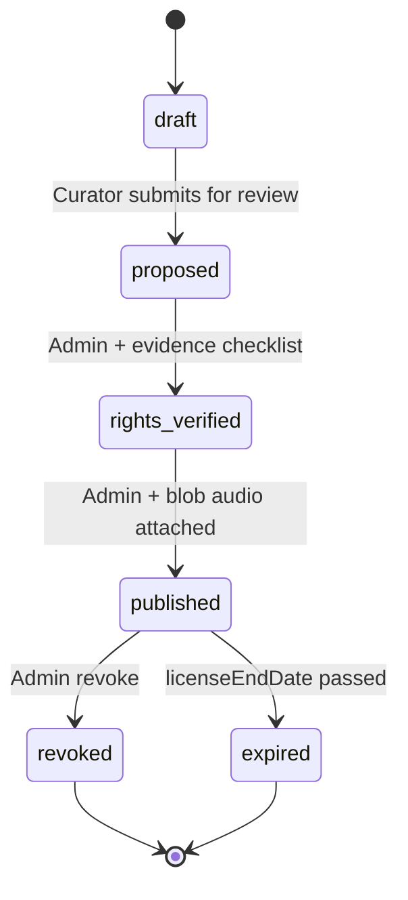

# Share Your Story music — Phase 2 design (pre-implementation)

**Branch:** `fix/story-music-hybrid` only · **No Marriage Hub** · **No deploy / merge / purchase / prod flag enable**

**Status:** Design approval gate — **do not implement** until leadership signs this document (or annotated exceptions).

---

## Decisions incorporated

| # | Decision | Design response |
|---|----------|-----------------|
| 1 | Church-authorized pilot only | No licensed B2B provider adapter in Phase 2 |
| 2 | Three real tracks (GH, NG, US) | Intake **placeholders**; **no audio ingest** until rights rows are `rights_verified` with evidence |
| 3 | Vercel Blob long-term | Private blob + **server-mediated stream**; deprecate committed `public/story-music/*` for production |
| 4 | DB-backed catalog & audit | Prisma models replace JSON catalog, JSON intake, JSONL audit |
| 5 | Documentary evidence + UGC story rights | Evidence attachments + checklist fields; admin verify gate |
| 6 | Expiry / revoke / territory | DB fields + runtime filters on search/playback/stream |
| 7 | Worship proposes, admin publishes | Curator role vs admin role (below) |
| 8 | Preserve `musicTrackId` | Unchanged story columns; migration map + catalog `trackId` |
| 9 | Read-only legacy usage | Staging or sanitized export only (procedure below) |
| 10 | Staging plan | Isolated env, migrations, test assets |
| 11 | Desktop + Android WebView | Test matrix (reuse + extend pilot plan) |
| 12 | Stream abuse | Proxy-only playback; no long-lived public blob URLs |
| 13–14 | Prod flags off; no deploy without approval | Explicit checklist |

---

## 1. Proposed Prisma schema

New models (namespaced `StoryMusic*`). Existing `CommunityStatus` **unchanged**.

```prisma
/// Rights intake + legal metadata (one row per licensed recording)
model StoryMusicRightsRecord {
  id                      String   @id
  status                  String   // draft | proposed | rights_verified | published | revoked | expired | withdrawn
  artist                  String
  title                   String
  recordingOwner          String
  compositionPublishing   String
  documentReference       String   // contract / email / license id (offline vault)
  evidenceSummary         String?  // what was reviewed (no PII)
  authorizedUses          String   // must include story background UGC wording
  streamingPermitted      Boolean  @default(false)
  storagePermitted        Boolean  @default(false)
  territory               String   // e.g. Worldwide, GH+NG+US
  territoryCodesJson      String?  // ["GH","NG","US"] for machine checks
  licenseStartDate        DateTime?
  licenseEndDate          DateTime?
  revocationContact       String?
  catalogTrackId          String   @unique // stable musicTrackId
  country                 String?
  language                String?
  genresJson              String?
  tagsJson                String?
  startSeconds            Int?
  /// Logical ref: story-music://blob/{pathname} — never public URL
  audioStorageRef         String?
  audioContentType        String?
  audioByteLength         Int?
  proposedByUserId        String?
  proposedAt              DateTime?
  verifiedAt              DateTime?
  verifiedByUserId        String?
  publishedAt             DateTime?
  publishedByUserId       String?
  revokedAt               DateTime?
  revokedByUserId         String?
  revokeReason            String?
  notes                   String?
  createdAt               DateTime @default(now())
  updatedAt               DateTime @updatedAt

  catalogEntry            StoryMusicCatalogTrack?
  evidenceFiles           StoryMusicRightsEvidence[]
  auditEvents             StoryMusicAdminAuditEvent[]

  @@index([status])
  @@index([catalogTrackId])
}

/// Playable catalog row (derived from published rights)
model StoryMusicCatalogTrack {
  id                String   @id // same as catalogTrackId / musicTrackId
  rightsRecordId    String   @unique
  rightsRecord      StoryMusicRightsRecord @relation(fields: [rightsRecordId], references: [id])
  title             String
  artist            String
  providerKind      String   @default("church_authorized")
  audioStorageRef   String
  audioContentType  String?
  startSeconds      Int?
  country           String?
  language          String?
  genresJson        String?
  tagsJson          String?
  playability       String   @default("playable") // playable | unavailable
  publishedAt       DateTime
  revokedAt         DateTime?

  @@index([playability])
  @@index([country])
}

/// Documentary evidence metadata (files in private blob)
model StoryMusicRightsEvidence {
  id               String   @id
  rightsRecordId   String
  rightsRecord     StoryMusicRightsRecord @relation(fields: [rightsRecordId], references: [id])
  label            String   // e.g. "Signed license PDF"
  storageRef       String   // private blob pathname ref
  contentType      String
  byteLength       Int
  uploadedByUserId String
  uploadedAt       DateTime @default(now())

  @@index([rightsRecordId])
}

/// Append-only admin/curator audit (DB-backed; exportable)
model StoryMusicAdminAuditEvent {
  id           String   @id
  at           DateTime @default(now())
  actorUserId  String
  actorRole    String   // admin | curator
  action       String
  targetType   String   // rights | catalog | migration | stream
  targetId     String?
  summary      String
  metaJson     String?

  rightsRecordId String?
  rightsRecord   StoryMusicRightsRecord? @relation(fields: [rightsRecordId], references: [id])

  @@index([at])
  @@index([actorUserId])
}

/// Legacy YouTube-catalog id → authorized audio (preserves musicTrackId on stories)
model StoryMusicLegacyMigrationMap {
  legacyTrackId   String   @id
  rightsRecordId  String?
  catalogTrackId  String?  // usually same as legacyTrackId
  audioStorageRef String?
  status          String   // planned | ready | published | skipped
  notes           String?
  updatedAt       DateTime @updatedAt
  updatedByUserId String?
}

/// Aggregate usage snapshot (optional cache from report job — no member ids)
model StoryMusicLegacyUsageSnapshot {
  id              String   @id
  capturedAt      DateTime @default(now())
  source          String   // staging | sanitized_export
  rowsJson        String   // [{ musicTrackId, totalStories, activeStories }]
}
```

**Migration file:** `prisma/migrations/YYYYMMDDHHMMSS_story_music_phase2/migration.sql` — create tables only; **no** changes to `CommunityStatus`.

**Data migration (one-time job, post-approval):**

1. Import `data/story-music-rights-records.json` → `StoryMusicRightsRecord` (if any).  
2. Import `data/story-music-authorized-catalog.json` → `StoryMusicCatalogTrack` + links.  
3. Import `data/story-music-legacy-migration-map.json` → `StoryMusicLegacyMigrationMap`.  
4. Import tail of `story-music-admin-audit.jsonl` → `StoryMusicAdminAuditEvent` (optional).  
5. Freeze JSON writes; feature flag `STORY_MUSIC_DB_CATALOG=1` switches readers to Prisma.

---

## 2. Access-control design

| Action | Curator (worship staff) | Admin (`canManageAsAdmin`) |
|--------|-------------------------|----------------------------|
| Propose intake (`draft` → `proposed`) | ✅ | ✅ |
| Upload evidence files | ✅ (own proposals) | ✅ |
| Edit draft / proposed metadata | ✅ (own) | ✅ all |
| Mark **rights verified** | ❌ | ✅ |
| Publish to catalog | ❌ | ✅ |
| Revoke / expire override | ❌ | ✅ |
| View audit log | ✅ (redacted) | ✅ full |
| Legacy usage report | ❌ | ✅ |
| Migration map publish | ❌ | ✅ |

**Curator identity:**

- `STORY_MUSIC_CURATOR_USER_IDS` — comma-separated user ids (verified via session, not self-claimed role).  
- Admins always inherit curator powers.  
- Enforced in `story-music-admin-access.ts` (split `assertStoryMusicCurator` / `assertStoryMusicAdmin`).

**Evidence:**

- Stored in **private** Vercel Blob prefix `story-music-rights-evidence/{rightsRecordId}/…`.  
- Download via **admin-only** API; never linked from participant UI.

---

## 3. Storage architecture

### 3.1 Production path (target)

```
Upload (admin) → private Blob put (access: private)
              → StoryMusicRightsRecord.audioStorageRef = "story-music://blob/{pathname}"
Publish       → StoryMusicCatalogTrack.audioStorageRef (copy ref)
Playback      → GET /api/community/story-music/stream?trackId=
              → server: authz + territory + expiry + resolve ref → blob get (server) → stream body
```

**Do not** return permanent blob HTTPS URLs to the browser. **Do not** commit masters to `public/`.

### 3.2 Blob configuration (staging)

| Env | Purpose |
|-----|---------|
| `BLOB_READ_WRITE_TOKEN` | Existing store or dedicated prefix |
| Optional `STORY_MUSIC_BLOB_PREFIX` | `story-music/audio/` |
| Optional dedicated token | Isolate from public community media (recommended) |

POC WAVs remain under `public/story-music-poc/` for **local QA only**, gated by `STORY_MUSIC_POC_CATALOG_ENABLED`.

### 3.3 Three pilot recordings (placeholders — no ingest yet)

| Pilot slot | Country | `catalogTrackId` (proposed) | Status |
|------------|---------|----------------------------|--------|
| Ghana | GH | `auth-gh-pilot-01` | Awaiting rights + evidence |
| Nigeria | NG | `auth-ng-pilot-01` | Awaiting rights + evidence |
| United States | US | `auth-us-pilot-01` | Awaiting rights + evidence |

Intake rows created in **draft** only after implementation; **no** `audioStorageRef` until legal sign-off.

Legacy remaps (e.g. `way-maker`) remain via `StoryMusicLegacyMigrationMap` when approved — **same** `musicTrackId`.

---

## 4. Rights approval workflow (Phase 2)



**Evidence checklist (admin, non-automated):**

- [ ] Written permission for **in-app user-generated story background audio**  
- [ ] **Master** recording owner sign-off  
- [ ] **Composition/publishing** clearance or PRO note documented  
- [ ] **Streaming** + **storage** explicitly allowed  
- [ ] **Territory** matches `territoryCodesJson`  
- [ ] **License end date** set if time-bound  
- [ ] Evidence file(s) uploaded and referenced  

**Runtime enforcement:**

- `searchStoryMusicTracks`: exclude non-`published`, expired, revoked, wrong territory (optional member country from profile later).  
- `assertTrackAttachable`: same checks.  
- `stream`: re-validate before every byte range.

---

## 5. Streaming security (signed URLs are not DRM)

| Risk | Mitigation |
|------|------------|
| Shared blob URL leaks | **No client-facing blob URLs**; stream route only |
| Direct download / curl | Short session-bound stream; optional `Cache-Control: private, no-store`; rate limit per user/ip |
| Range scraping full file | Accept for playback; **log** excessive range patterns; consider max duration cap for story context |
| IDOR on `trackId` | Catalog lookup + published state only |
| Curator/evidence exfiltration | Admin/curator auth on evidence routes |
| Revoked track still cached | CDN cache disabled on stream; `ETag` tied to `updatedAt` |

**Assumption:** Determined users can capture audio playing on device — legal protection is **license**, technical is **access control + audit**, not unbreakable DRM.

---

## 6. Legacy usage analysis (approved, read-only)

**Allowed sources:** Staging DB clone **or** sanitized production export (no `authorId` in export file).

**Command (post Phase 2 can snapshot to DB):**

```bash
npm run report:story-music:legacy-usage
# optional: STORY_MUSIC_USAGE_SNAPSHOT=1 → write StoryMusicLegacyUsageSnapshot
```

**Rules:**

- SELECT / GROUP BY only; no UPDATE/DELETE.  
- Output: `musicTrackId`, counts, catalog label — **never** member identifiers.  
- Runbook owner: engineering + admin worship lead.

---

## 7. Staging deployment plan (not executed)

| Step | Action |
|------|--------|
| 1 | Branch deploy `fix/story-music-hybrid` to **staging** project only (separate Vercel project) |
| 2 | Staging DB: run Prisma migrate for `StoryMusic*` tables |
| 3 | Env: `STORY_MUSIC_HYBRID_ENABLED=1`, `NEXT_PUBLIC_STORY_MUSIC_HYBRID_ENABLED=1`, `STORY_MUSIC_DB_CATALOG=1`, `STORY_MUSIC_POC_CATALOG_ENABLED=0`, `STORY_MUSIC_ADMIN_WRITE_ENABLED=1`, Blob token |
| 4 | **Production env unchanged** — all story flags unset |
| 5 | Ingest **authorized test asset** (original short clip or licensed pilot once ready) to staging blob |
| 6 | Execute [STORY_MUSIC_PILOT_TEST_PLAN.md](./STORY_MUSIC_PILOT_TEST_PLAN.md) + Android APK |
| 7 | Run legacy usage report on staging DB |
| 8 | Leadership go/no-go before production |

---

## 8. Playback validation matrix (staging)

| Case | Desktop | Android WebView |
|------|---------|-----------------|
| Preview before attach | Chrome, Edge, Safari | Capacitor APK |
| User tap-to-play / mute | Required pass | Required pass |
| Story slide transition | Stop / continue same trackId | Same |
| Unavailable legacy id | Graceful UI | Same |
| Revoked track mid-pilot | Unavailable on new views | Same |
| Territory-restricted (if tested) | Hidden from search | Same |

Automated: existing `test:story-music:hybrid`, `security`, `admin`; add **`test:story-music:db-catalog`** and **`test:story-music:stream-authz`** after implementation.

---

## 9. Implementation sequence (after this design is approved)

1. Prisma migration + stores (`story-music-db.ts`).  
2. Blob upload + `audioStorageRef` resolver.  
3. Replace JSON/JSONL writers; dual-read period with JSON fallback flag.  
4. Curator vs admin APIs + UI tabs on `/admin/story-music`.  
5. Stream route → blob proxy + authz.  
6. Migrate JSON → DB one-shot script.  
7. Staging deploy (explicit approval).  
8. Pilot intakes for GH / NG / US (metadata only until legal).

---

## 10. Remaining requirements / open items

| Item | Owner | Blocker |
|------|-------|---------|
| Signed licenses for 3 pilot recordings | Church / legal | Audio ingest |
| Evidence vault process (where PDFs live offline) | Admin | Verify step |
| Staging Vercel project + DB URL | Engineering | Deploy plan step 1 |
| Top-N legacy ids from usage report | Admin + worship | Migration priority |
| Dedicated Blob store vs prefix on shared store | Engineering | Security preference |
| Member territory for playback (optional) | Product | Future territory filter |
| Rate limits on stream route | Engineering | Implementation |
| Prisma evidence retention policy | Legal | GDPR/storage |

---

## 11. Explicit non-actions (unchanged)

- No merge to `main`  
- No production deploy  
- No enterprise music subscription  
- No copyrighted commercial downloads  
- No production feature flags enabled  
- No Marriage Counseling Hub changes  

---

## Approval

| Role | Name | Date | Approved |
|------|------|------|----------|
| Leadership | | | ☐ |
| Legal / worship | | | ☐ |
| Engineering | | | ☐ |

Once approved, implementation proceeds in sub-PRs on `fix/story-music-hybrid` per §9.
