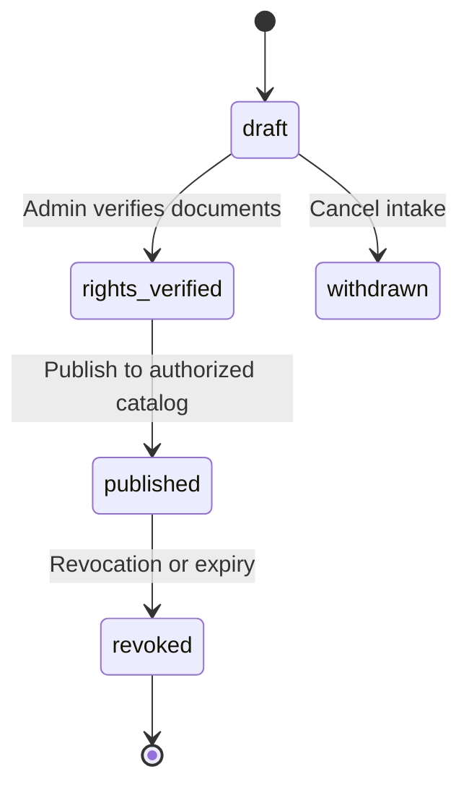

# Share Your Story — music rights intake process

**Version:** 1.0 (pilot)  
**Owner:** Church administration + worship leadership  
**Engineering:** `fix/story-music-hybrid` admin workflow mirrors this process.

## Purpose

No recording is added to the **attachable** story music catalog until rights are documented and verified. This process covers **church-authorized** recordings (regional gospel and worship). Licensed B2B catalog tracks follow the vendor agreement separately.

## Required intake fields

| Field | Description |
|-------|-------------|
| **Artist** | Performing artist name(s) as credited |
| **Song title** | Composition title as credited |
| **Recording owner** | Label, artist, or church entity that controls the **master** recording |
| **Composition / publishing** | Publisher(s), songwriter(s), CCLI / PRO references if applicable |
| **Document reference** | Signed license, email authorization, or contract id (stored offline; reference only in system) |
| **Authorized uses** | Must explicitly include **in-app user-generated story background audio** (not only live service) |
| **Streaming** | Permission to stream to members via HTTPS in app/WebView |
| **Storage** | Permission to store master or church-encoded file on church-controlled storage (e.g. Vercel Blob) |
| **Territory** | Countries/regions where members may use the track (e.g. worldwide, GH+NG only) |
| **License start / end** | Effective dates; **end** required when time-limited |
| **Revocation contact** | Who may revoke and how (written notice channel) |

## Workflow states

| State | Attachable in app? |
|-------|-------------------|
| `draft` | No |
| `rights_verified` | No (until published) |
| `published` | Yes (if hybrid enabled + playable file) |
| `revoked` | No — existing stories show unavailable playback |
| `expired` | No — auto from `licenseEndDate` |

## Verification checklist (human)

Before **rights_verified**, confirm in writing:

1. [ ] Story **background** use is explicitly permitted (not implied from “church use”).  
2. [ ] **Streaming** to members in the mobile app and website is permitted.  
3. [ ] **Storage** of an encoded file on church infrastructure is permitted.  
4. [ ] **Territory** matches member distribution.  
5. [ ] **Duration** and renewal process documented.  
6. [ ] **Revocation** clause understood (remove from catalog, playback unavailable; stories retain metadata).

## Revocation and expiration

- **Revocation:** Admin sets record to `revoked`; catalog entry removed or marked unavailable; audit log entry required.  
- **Expiration:** Nightly or on-read check of `licenseEndDate`; treat as `expired` (same playback behavior as revoked).  
- **Published stories:** `musicTrackId` **never deleted** from `CommunityStatus`; playback resolves to **unavailable** with graceful UI.

## Engineering records

- Intake JSON: `data/story-music-rights-records.json` (pilot; migrate to DB before scale).  
- Authorized catalog: `data/story-music-authorized-catalog.json`.  
- Audit: `data/story-music-admin-audit.jsonl` (append-only).

Admin API: `/api/admin/story-music/*` (Admin Group only). Writes require `STORY_MUSIC_ADMIN_WRITE_ENABLED=1` (off in production by default).

## Prohibited

- Uploading commercial masters without completed intake.  
- Publishing from admin UI without `rights_verified` transition.  
- Using POC `poc-*` ids for real releases.
